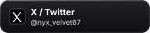
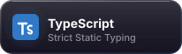
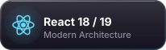
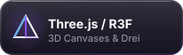
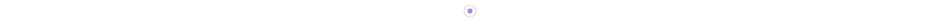
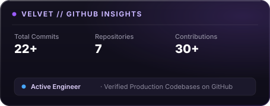
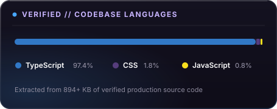

 

 

&nbsp;

&nbsp;

&nbsp;

  

### ✦ About Me

Hey, I'm **Rohit** — known online as **Velvet**.

I build software and obsess over how it actually feels to interact with. Most of my engineering time is split between two distinct crafts:

- **Kinetic 3D Web & Creative Interfaces**: Building WebGL viewports, GPU-instanced particle fields, procedural Web Audio soundscapes, and physics-driven cursors that make web applications feel like high-end native software.
- **Low-Latency Systems & Desktop Utilities**: Digging into Windows internals, MMCSS multimedia thread scheduling, and engineering native desktop suites in **Rust** and **Tauri v2** to eliminate micro-stutters and input lag.
- **Active Digital Communities**: I founded and developed the platform for **LovePixels**, an interactive Discord community with over **15,400 members** where we've hosted 50+ live gaming tournaments and distributed more than **₹2,00,000** in verified creator rewards.

I care deeply about the micro-details most people skip — 1px glass specular highlights, sub-millisecond input response, zero layout shift, and interfaces that feel tactile, responsive, and luxurious to touch.

  

### ⚡ Technology Arsenal

 

 

  

 

  

 

  

 

 

 

### 🚀 Selected Works

<table>
  <tr>
    <td width="50%" valign="top">
      <h3 align="left">
        <a href="https://velvet-portfolio.vercel.app/">Velvet — 3D Creative Portfolio</a>
      </h3>
      
<b>Generative WebGL Particle-Art Portfolio</b>

      
My flagship creative portfolio built with Next.js 14 and React Three Fiber. Features GPU-instanced particle chambers, GLSL custom shaders, adaptive hardware quality tiers (benchmarking device capabilities to hold a locked 60 FPS), and a procedural Web Audio soundscape.

      

        <code>Next.js 14</code> · <code>Three.js / R3F</code> · <code>GLSL</code> · <code>GSAP</code> · <code>Tailwind</code> · <code>TypeScript</code>
      

      

        🌐 <a href="https://velvet-portfolio.vercel.app/"><b>Live Experience</b></a> &nbsp;|&nbsp;
        📂 <a href="https://github.com/Velvettt-67/Velvet-Portfolio"><b>Source Code</b></a>
      

    </td>
    <td width="50%" valign="top">
      <h3 align="left">
        <a href="https://github.com/Velvettt-67/Nyx-AimXis">AimXis Services</a>
      </h3>
      
<b>Gaming Performance &amp; Latency Tuning Platform</b>

      
A web platform engineered for competitive esports players, focusing on input delay reduction, Windows OS debloating, and system diagnostics. Features real-time benchmark counters, stock vs. tuned comparison matrices, and Discord client routing.

      

        <code>Next.js 16</code> · <code>React 19</code> · <code>Framer Motion 12</code> · <code>Tailwind v4</code> · <code>TypeScript</code>
      

      

        📂 <a href="https://github.com/Velvettt-67/Nyx-AimXis"><b>Repository</b></a> &nbsp;|&nbsp;
        ⚡ <b>Status:</b> Production Ready
      

    </td>
  </tr>
  <tr>
    <td width="50%" valign="top">
      <h3 align="left">
        <a href="https://github.com/Velvettt-67/lovepixel.Mc">LovePixels Community Hub</a>
      </h3>
      
<b>Community Platform &amp; Live Discord Bridge</b>

      
The interactive web platform and real-time backend bridge powering the LovePixels community (15,400+ members). Features live Discord voice salon occupancy streaming, verified payout transparency ledgers (₹2,00,000+ distributed), and tournament schedules.

      

        <code>React 19</code> · <code>Vite 8</code> · <code>GSAP</code> · <code>Lenis</code> · <code>Express 5</code> · <code>Discord API</code>
      

      

        💬 <a href="https://discord.gg/lovepixel"><b>Discord (15k+ Members)</b></a> &nbsp;|&nbsp;
        📂 <a href="https://github.com/Velvettt-67/lovepixel.Mc"><b>Source Code</b></a>
      

    </td>
    <td width="50%" valign="top">
      <h3 align="left">
        <a href="https://github.com/Velvettt-67">QuantumTweaker Pro</a>
      </h3>
      
<b>Low-Latency Windows Optimizer &amp; FPS HUD</b>

      
A native Windows system tuning suite engineered in Rust and Tauri v2. Eliminates background CPU scheduling contention via MMCSS multimedia optimization, fine-tunes thread priority scheduling, and provides zero-overhead telemetry polling directly via Windows kernel APIs.

      

        <code>Rust</code> · <code>Tauri v2</code> · <code>Windows Kernel APIs</code> · <code>Tokio</code>
      

      

        ⚡ <b>Type:</b> Standalone Portable x64 &amp; Installer
      

    </td>
  </tr>
</table>

  

### 📊 GitHub Activity & Insights

&nbsp;

  

  

  

 

